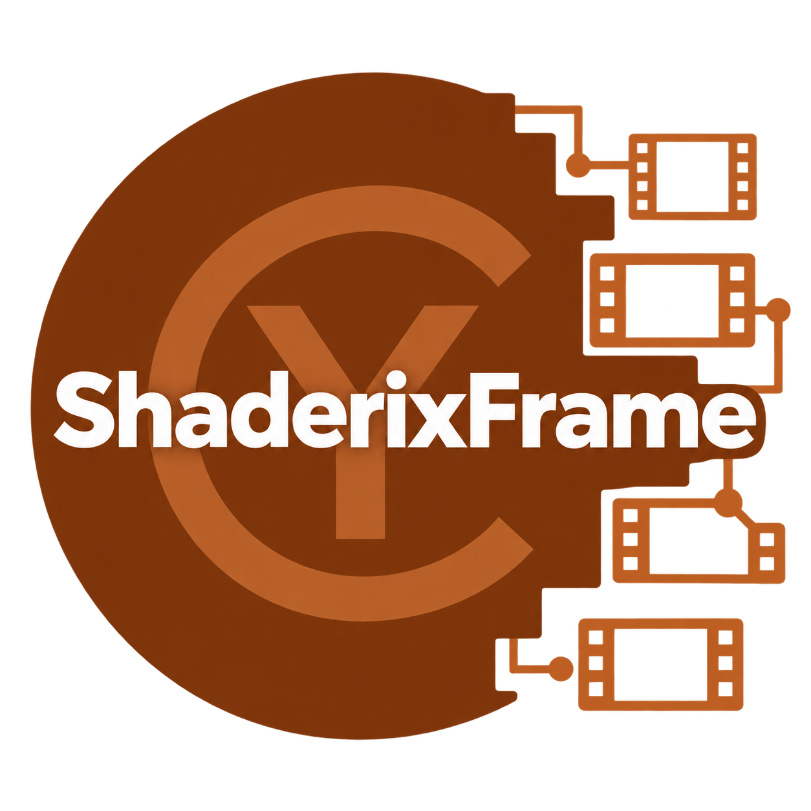
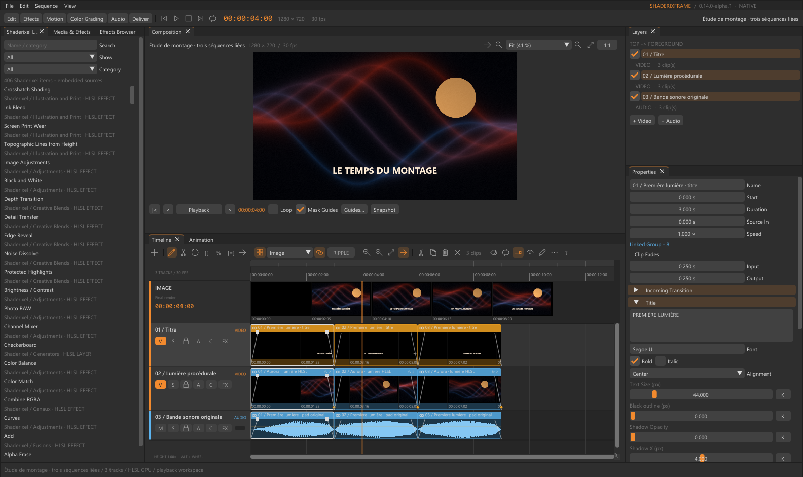
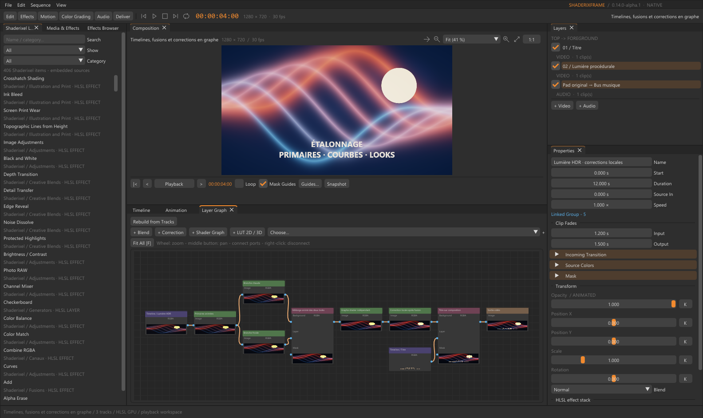
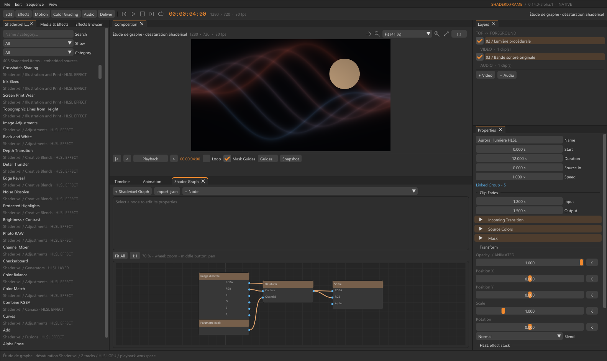
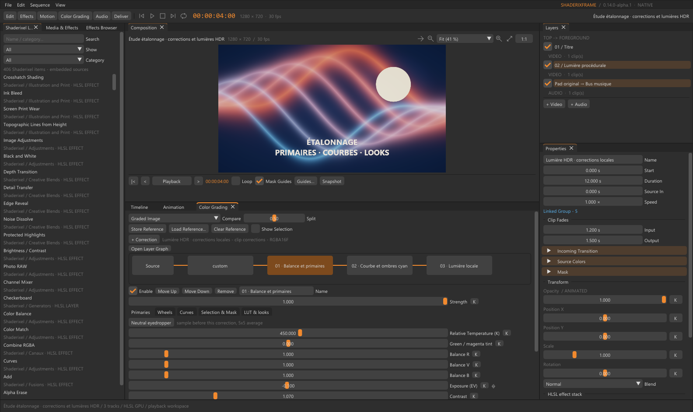
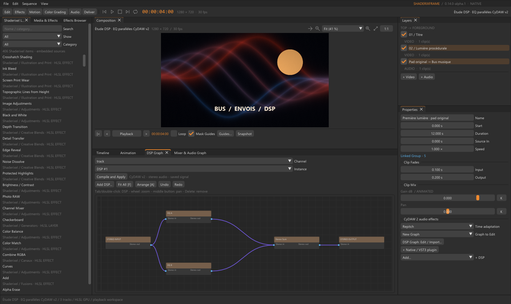
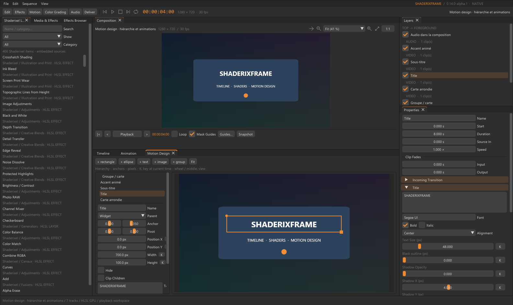
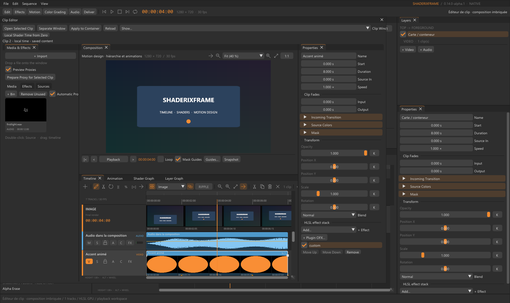

<table width="100%">
  <tr>
    <td width="30%" align="left" valign="top">
      <a href="https://mrmybal.github.io/ShaderixFrame/Documentation.html#/fr/welcome">Documentation</a><br>
      <a href="https://github.com/MrMybal/ShaderixFrame">Dépôt des sources</a><br>
      <a href="https://github.com/MrMybal/ShaderixFrame/issues">Suivi des problèmes</a><br><br>
      <sub>README</sub><br>
      <a href="README.md">English</a> · <a href="README.fr.md">Français</a>
    </td>
    <td width="40%" align="center" valign="middle">
      
    </td>
    <td width="30%" align="right" valign="top">
      <p><sub>Licence de l’application</sub><br><a href="LICENSE"><strong>GNU AGPL v3 uniquement</strong></a></p>
      <p><sub>Version</sub><br><a href="docs/RELEASE_0.14-alpha.2.fr.md"><strong>0.14.0-alpha.2</strong></a><br><strong>ALPHA</strong></p>
      <p><a href="https://github.com/MrMybal/ShaderixFrame/releases/tag/v0.14.0-alpha.2"><strong>Télécharger</strong></a><br><sub>Windows x64 · installateur / portable</sub></p>
    </td>
  </tr>
</table>

<h1 align="center">ShaderixFrame</h1>
<p align="center">Par <a href="https://github.com/MrMybal">Cyberalien</a></p>

Un éditeur vidéo natif pour Windows, consacré au montage, aux VFX en HLSL, à la
composition par calques, au motion design et au traitement audio. Assemblez des
clips sur une timeline, construisez vos graphes de traitement d’image et de son,
puis animez et exportez le résultat.

> **ALPHA · 0.14.0-alpha.2**
>
> Une version expérimentale destinée aux essais et aux retours ; les fonctions et
> la compatibilité peuvent encore évoluer. L’alpha 2 ajoute le manuel CyDoc bilingue,
> l’aide contextuelle et la référence des API publiques. Consultez les
> [notes de version et limites connues](docs/RELEASE_0.14-alpha.2.fr.md).

[](docs/screenshots/editing.png)

Les captures montrent la **0.14.0-alpha.1** avec les projets d’exemple fournis.
Cliquez sur une image pour la voir en taille réelle ; les noms et titres des
projets peuvent être en français.

## L’application

Importez vidéos, images et sons, assemblez les clips liés, rognez-les ou changez
leur vitesse, puis ajoutez titres, masques et transitions. Un clip peut contenir
sa propre timeline, ses effets et ses graphes. Six espaces couvrent **Edit**,
**Effects**, **Motion**, **Color Grading**, **Audio** et **Deliver**. Les panneaux
peuvent être fermés, ancrés ou détachés sur un autre écran. L’interface démarre en
anglais ; le français est disponible dans **View > Appearance**.

Le compilateur de shaders et les algorithmes de composition de Shaderixel servent
de fondation aux graphes d’image. Les graphes de pistes traitent chaque piste,
le graphe de calques mélange leurs surfaces et les graphes de shaders définissent
les effets HLSL. CyDAW v2 apporte le moteur DSP, la validation des graphes audio
et l’analyse du signal ; CyUI fournit les composants d’interface communs.

| Composition des calques | Graphe de shaders HLSL |
| --- | --- |
| [](docs/screenshots/layer-graph.png) | [](docs/screenshots/shader-graph.png) |
| Mélangez les pistes et créez des branches de correction avec aperçu des nœuds. | Créez des effets en reliant nœuds de shaders et paramètres. |

| Étalonnage colorimétrique | Graphe audio DSP |
| --- | --- |
| [](docs/screenshots/color-grading.png) | [](docs/screenshots/audio-dsp.png) |
| Empilez les corrections et réglez balance, exposition et contraste. | Faites passer le son stéréo par des branches de traitement parallèles. |

| Motion design | Éditeur de clip imbriqué |
| --- | --- |
| [](docs/screenshots/motion-design.png) | [](docs/screenshots/clip-editor.png) |
| Disposez textes et formes avec une hiérarchie et un canevas. | Modifiez la timeline locale, la composition et les effets d’un conteneur. |

## Fonctionnalités

- **Montage :** clips vidéo/audio liés, vignettes, formes d’onde, rognage,
  changement de vitesse, timelines imbriquées, marqueurs, régions, sous-titres
  et courbes d’images clés.
- **VFX et composition :** graphes distincts pour les calques et les shaders,
  effets de pistes, 406 effets et générateurs Shaderixel, masques et transitions.
- **Couleur :** primaires, roues, courbes, sélections, masques locaux, scopes
  et LUT 1D/2D/3D. La composition interne utilise RGBA16F ; les exports PNG16
  et EXR half sont disponibles. Le décodage et l’encodage vidéo restent en 8 bits.
- **Audio :** graphes DSP CyDAW v2, 50 effets d’insertion stéréo, mixeur, bus,
  envois, automation, analyse de sonie et compensation de latence. Les plugins
  audio natifs/VST3 et le sous-ensemble OpenFX CPU RGBA pris en charge utilisent
  des processus isolés.
- **Livraison et récupération :** export MP4/WAV/AVI/PNG/EXR/GIF en arrière-plan,
  échange EDL/SRT, historique d’annulation, versions des projets et récupération
  de session.
- **Automatisation et aide :** serveur MCP stdio intégré avec 163 outils et
  manuel CyDoc anglais/français comprenant guides et références MCP/SDK C/C++ publics.

### Documentation

[Ouvrir le manuel français](https://mrmybal.github.io/ShaderixFrame/Documentation.html#/fr/welcome)
ou [read the English manual](https://mrmybal.github.io/ShaderixFrame/Documentation.html#/en/welcome).
Les deux ouvrent le même lecteur visuel que le logiciel, avec navigation,
recherche, captures, schémas et galerie des espaces de travail.

**Help > User Manual** ouvre le fichier fourni `Documentation/Documentation.html`
par URL `file://` ; **Ctrl+F1** choisit l’aide du panneau actif. Gardez tout le
dossier `Documentation/`, dont `DocData/`, à côté de l’exécutable. La lecture
fonctionne hors ligne, sans serveur, CDN ni environnement Node. **Ctrl+K** lance
la recherche ; les images s’agrandissent dans la fenêtre et **Imprimer le guide**
ouvre le guide complet.

---

## Installation

La version publiée cible **Windows 10/11 x64** et **Direct3D 11**.
L’application et l’installateur ne sont pas signés. Les utilisateurs fournissent
leurs plugins tiers ; les paquets Windows incluent le processus VST3 compatible.

1. [Téléchargez la version 0.14.0-alpha.2](https://github.com/MrMybal/ShaderixFrame/releases/tag/v0.14.0-alpha.2).
   Choisissez l’[installateur par utilisateur](https://github.com/MrMybal/ShaderixFrame/releases/download/v0.14.0-alpha.2/ShaderixFrame-0.14.0-alpha.2-Setup.exe)
   ou le [ZIP portable](https://github.com/MrMybal/ShaderixFrame/releases/download/v0.14.0-alpha.2/ShaderixFrame-0.14.0-alpha.2-windows-x64.zip).
2. Lancez Setup, ou extrayez toute l’archive portable dans un dossier accessible
   en écriture. Gardez les processus auxiliaires, exemples, licences et documentation
   avec l’application.
3. Lancez `ShaderixFrame.exe`. Ouvrez **File > Open Project** et choisissez
   `examples/CutStudy.sframe`, ou importez vos médias avec **Ctrl+I**.

L’installateur ne demande pas de droits administrateur. L’application distribuée
ne nécessite pas les sources de Shaderixel ou CyDAW. `--warp` sélectionne le rendu
D3D11 logiciel. La release fournit les [sommes SHA-256](https://github.com/MrMybal/ShaderixFrame/releases/download/v0.14.0-alpha.2/SHA256SUMS.txt)
et les [sources correspondantes avec JUCE](https://github.com/MrMybal/ShaderixFrame/releases/download/v0.14.0-alpha.2/ShaderixFrame-0.14.0-alpha.2-source.zip).
Consultez les [limites de l’alpha](docs/RELEASE_0.14-alpha.2.fr.md#limites-connues) avant de l’évaluer.

## Sources, compilation et bibliothèques nécessaires

<details>
<summary>Compiler l’application Windows depuis les sources</summary>

Utilisez Windows x64, **Visual Studio 2022 avec les outils C++ x64**,
**CMake 3.24+**, **Ninja**, **Python 3** et **Node.js 22+ / npm**. Node sert
à générer l’aide ; ni l’application installée ni le lecteur n’en ont besoin.

```powershell
git clone https://github.com/MrMybal/ShaderixFrame.git
cd ShaderixFrame
npm ci --prefix .CyDocBuild --omit=peer --ignore-scripts
python tools/prepare_dependencies.py --audio-only
.\build.bat Release --safe-compile
```

Cette commande compile Release sans lancer les exécutables de test. L’application
obtenue est `build/Release/ShaderixFrame.exe`. Les sources de CyUI, Shaderixel,
CyDAW v2, Dear ImGui et OpenFX sont verrouillées dans `vendor/` ; CyDoc utilise
une archive locale et un fichier de verrouillage npm dans `.CyDocBuild/`.
Leurs licences sont répertoriées ci-dessous.

Le processus VST3 optionnel nécessite JUCE 8.0.15. Restaurez le processus compatible
depuis le ZIP portable publié, ou recompilez-le depuis l’archive complète des sources
correspondantes. Le [guide de compilation](docs/BUILDING.md), en anglais, détaille
ces étapes, les tests et la création des paquets. Le moteur audio/DSP natif et
l’hébergement OFX se compilent sans ce processus optionnel.

Pour régénérer et vérifier les deux langues de la documentation :

```powershell
python tools/build_cydoc.py --check --test
```

Le même export est fourni localement et déployé par le workflow de documentation
GitHub Actions. Consultez l’[outillage documentaire](.CyDocBuild/README.md) pour
la rédaction et le [SDK natif](sdk/README.md) pour les contrats des plugins ;
ces guides de développement sont en anglais. Les résultats de compilation,
médias générés et téléchargements optionnels restent hors de Git ; Git LFS
n’est pas nécessaire.

</details>

---

## Licence

**Le code et la documentation propres à ShaderixFrame utilisent [GNU AGPL version 3 uniquement](LICENSE)
(`AGPL-3.0-only`).** Copyright © 2026 Cyberalien. Les composants tiers conservent
leurs conditions. Consultez les [licences et sources correspondantes](docs/LICENSING.md).

### Application et composants natifs

| Bibliothèque · sources | Licence · texte | Utilisation / périmètre |
| --- | --- | --- |
| [Copie de Shaderixel](vendor/shaderixel) | [Copies autorisées par le propriétaire et provenance](NOTICE.md) | Compilateur de shaders, code de graphes/composition et bibliothèque d’effets ; sources fournies. |
| [Copie de CyDAW v2](vendor/cydaw2) | [GNU AGPL v3](vendor/cydaw2/LICENSE) | Moteur DSP, validation des graphes, analyse et sources du processus VST3. |
| [CyUI 1.2.0](https://github.com/MrMybal/CyUI) | [MIT](vendor/cyui/LICENSE) | Modules d’interface native ; sources verrouillées fournies. L’accès au dépôt amont peut nécessiter une autorisation. |
| [Dear ImGui](https://github.com/ocornut/imgui) | [MIT](vendor/imgui/LICENSE.txt) | Ancrage et interface native ; l’application fournit une cible partagée unique. |
| [Composants texte/syntaxe de CyUI](vendor/cyui/THIRD_PARTY_NOTICES.md) | [MIT et notices permissives de type HPND](vendor/cyui/THIRD_PARTY_NOTICES.md) | TextEditor, Lexilla, en-têtes Scintilla et données SciTE utilisés par l’éditeur de code. |
| [JUCE 8.0.15](https://github.com/juce-framework/JUCE) | [Double licence AGPL v3 / commerciale](vendor/juce-license/LICENSE.md) ; option AGPL utilisée ici | Processus VST3 uniquement ; sources exactes et notices des dépendances fournies avec les sources correspondantes. |
| [OpenFX](https://github.com/AcademySoftwareFoundation/openfx) | [BSD-3-Clause](vendor/openfx/LICENSE.md) | En-têtes OFX natifs et intégration de l’hôte ; certains exemples servent aussi aux tests de développement. |
| [CyDoc 0.1.0](https://github.com/MrMybal/CyDoc) | [MIT](.CyDocBuild/vendor/cydoc/LICENSE) | Lecteur hors ligne image/galerie et utilitaire natif de liens ; outils de génération séparés. |

Les API Windows fournissent D3D11, Media Foundation, WIC et les polices système.
Les polices système et plugins tiers des utilisateurs ne sont pas redistribués.
Les intégrations optionnelles CEF/navigateur et Unreal de CyUI ne sont pas utilisées ;
le manuel n’inclut pas d’environnement Three.js.

### Génération et vérification de la documentation

| Bibliothèque · sources | Licence · texte | Utilisation / périmètre |
| --- | --- | --- |
| [marked 17.0.6](https://github.com/markedjs/marked) | [MIT](https://github.com/markedjs/marked/blob/v17.0.6/LICENSE.md) | Compilation Markdown lors de la génération, via le paquet CyDoc verrouillé. |
| [PrismJS 1.30.0](https://github.com/PrismJS/prism) | [MIT](https://github.com/PrismJS/prism/blob/v1.30.0/LICENSE) | Coloration syntaxique lors de la génération. |
| [esbuild 0.25.12](https://github.com/evanw/esbuild) | [MIT](https://github.com/evanw/esbuild/blob/v0.25.12/LICENSE.md) | Assemblage de la documentation lors de la génération. |
| [Happy DOM 21.0.4](https://github.com/capricorn86/happy-dom) | [MIT](https://github.com/capricorn86/happy-dom/blob/v21.0.4/LICENSE) | Vérifications DOM de développement ; absent de l’application et du lecteur distribués. |

Ces tableaux répertorient les composants principaux, pas toutes les dépendances
transitives. Conservez [NOTICE.md](NOTICE.md), les [notices des composants CyUI](vendor/cyui/THIRD_PARTY_NOTICES.md)
et tous les fichiers de licence fournis avec les sources et les paquets Windows.

## Références et liens

- [Documentation française](https://mrmybal.github.io/ShaderixFrame/Documentation.html#/fr/welcome)
  · [English documentation](https://mrmybal.github.io/ShaderixFrame/Documentation.html#/en/welcome).
- [Notes de version et limites](docs/RELEASE_0.14-alpha.2.fr.md)
  · [Téléchargements](https://github.com/MrMybal/ShaderixFrame/releases/tag/v0.14.0-alpha.2).
- [Référence MCP et SDK](https://mrmybal.github.io/ShaderixFrame/Documentation.html#/fr/api-links)
  · [Guide de compilation en anglais](docs/BUILDING.md).
- [Dépôt des sources](https://github.com/MrMybal/ShaderixFrame)
  · [Suivi des problèmes](https://github.com/MrMybal/ShaderixFrame/issues).
