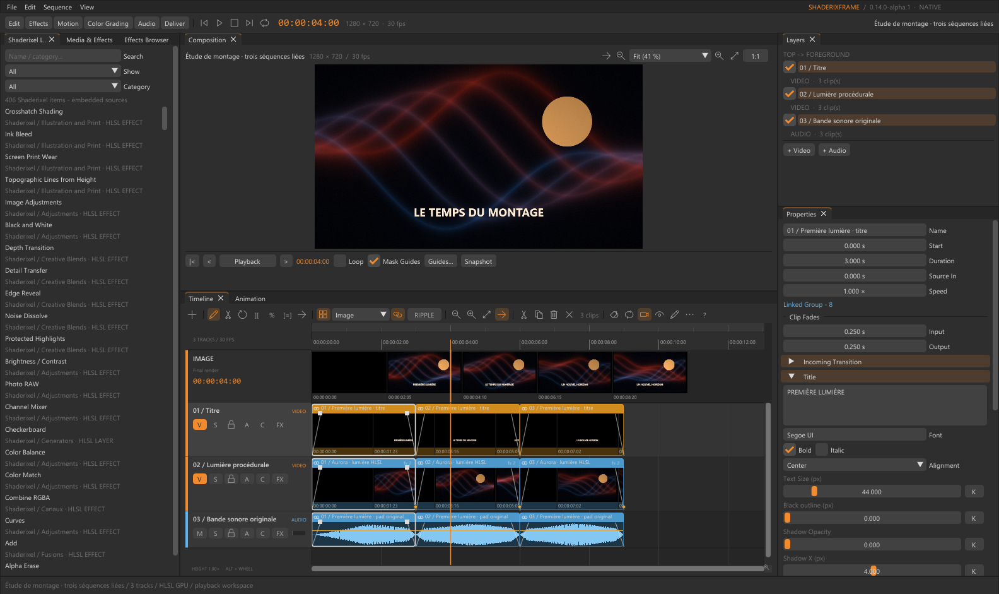
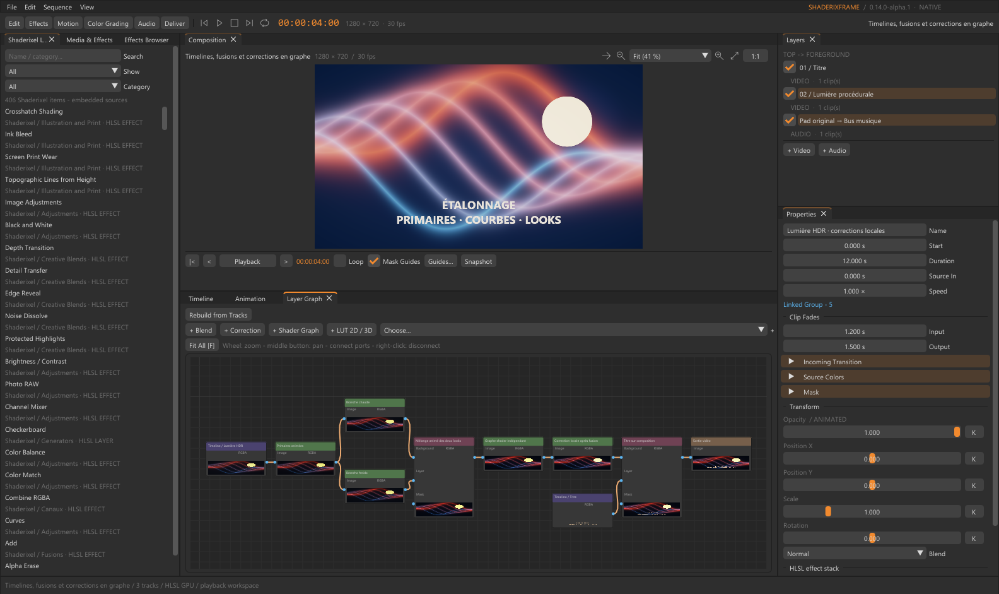
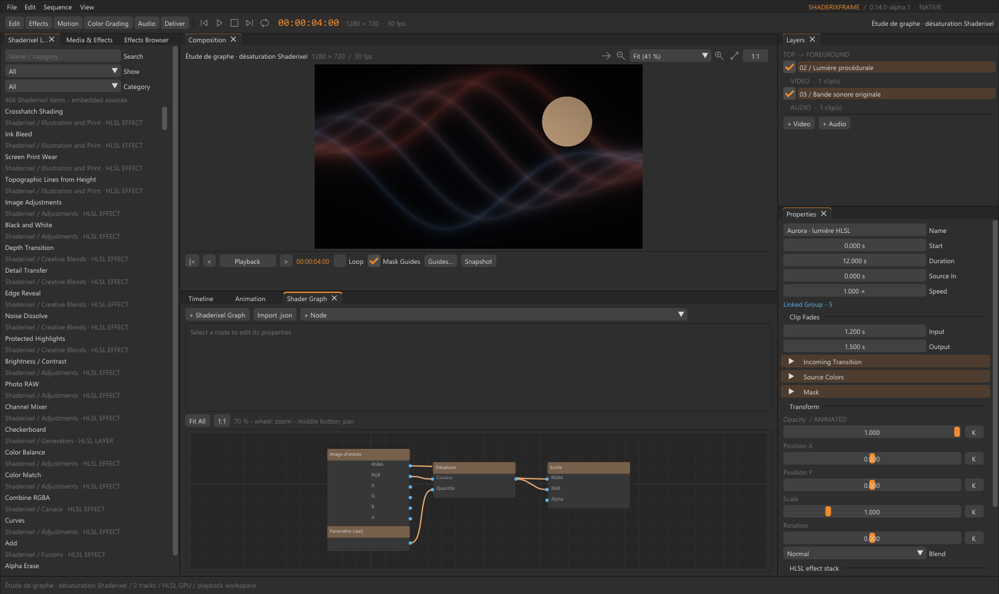
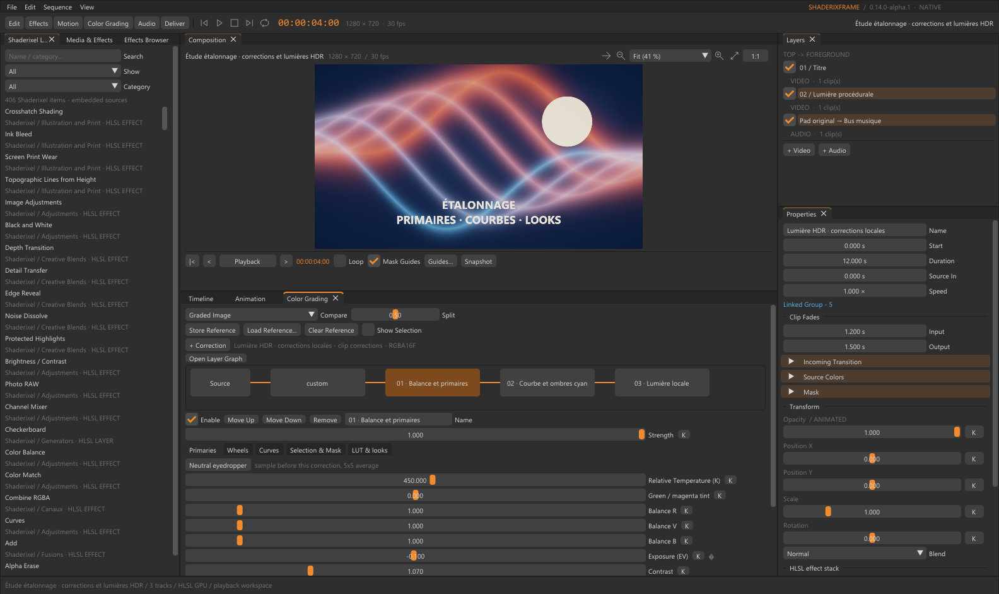
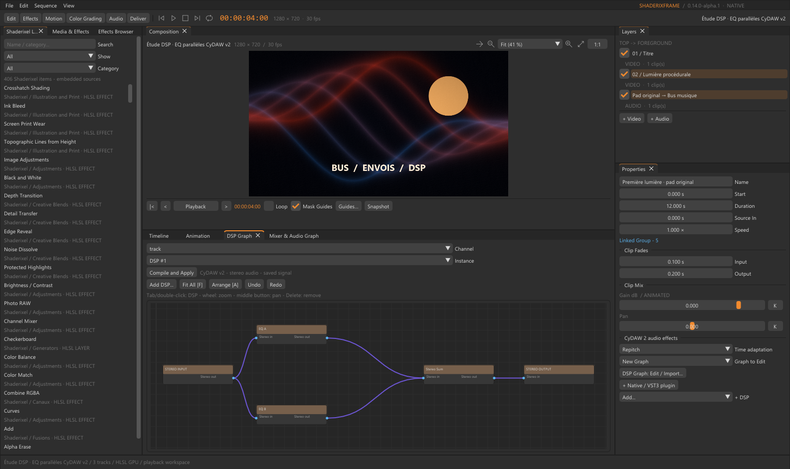
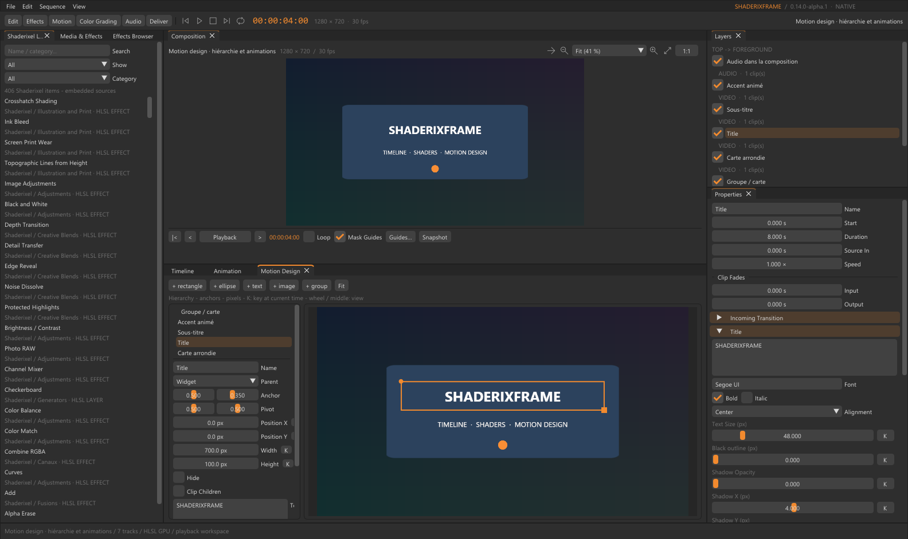
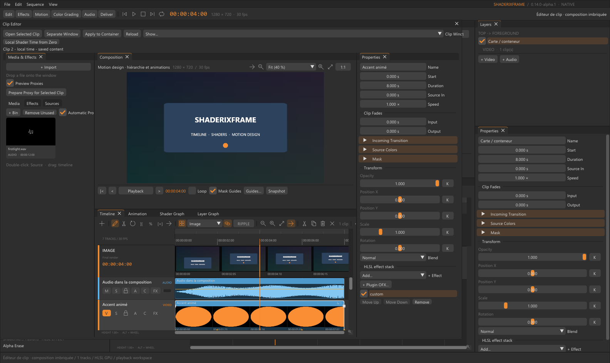

# ShaderixFrame 0.14.0-alpha.2

Development and maintenance: Cyberalien.

**Alpha preview for Windows x64.** Licensed under [GNU AGPL v3](LICENSE).
See [alpha downloads and limitations](docs/RELEASE_ALPHA.md) and [licensing/source information](docs/LICENSING.md).

**[Documentation](https://mrmybal.github.io/ShaderixFrame/#/en/welcome)** ·
[Documentation en français](https://mrmybal.github.io/ShaderixFrame/#/fr/welcome)

Read the complete CyDoc manual online, with the same reader, search, images and
diagrams as the help bundled with the application. The installed manual also works offline.

ShaderixFrame is a native Windows video editor with layered compositing, HLSL effects,
VFX graphs and audio editing. It uses modular CyUI for common interface components,
Shaderixel's shader graph compiler and composition algorithms, and CyDAW v2's DSP
engine and signal analysis.
The application starts in **English**. Imported projects keep their own clip names and text.
The current development UI migration is described in [CYUI_MIGRATION.md](docs/CYUI_MIGRATION.md).

Version 0.13 adds six workspaces, a CyDAW-style arrangement timeline and frame filmstrip,
a curve editor, detailed composition zoom, and **406 Shaderixel effects and generators**.
See [the release notes](docs/RELEASE_0.13.md) for version-specific details.

Version 0.14 migrates common UI to modular [CyUI](https://github.com/MrMybal/CyUI):
shared node editors, audio controls, grading/DSP curves, source monitor and code editor.
CyUI is MIT-licensed. See its
[pinned licence](https://github.com/MrMybal/CyUI/blob/8367401fe45fc22bfed5e227cb3de343177f676b/LICENSE)
and the [bundled licence](vendor/cyui/LICENSE).
See [0.14 release notes](docs/RELEASE_0.14.md).

Alpha 2 adds the complete bilingual CyDoc manual, contextual help and public API
reference. See [the alpha 2 changes](docs/RELEASE_0.14-alpha.2.md).

## Screenshots

Captured from **0.14.0-alpha.1** using the bundled example projects.
Click an image to view it at full size.

**Video editing** — composition preview, linked video/audio clips, frame filmstrip and waveforms.

[](docs/screenshots/editing.png)

| Layer compositing | HLSL shader graph |
| --- | --- |
| [](docs/screenshots/layer-graph.png) | [](docs/screenshots/shader-graph.png) |
| Blend tracks and branch corrections with live node previews. | Build effects by connecting shader nodes and parameters. |

| Color grading | Audio DSP graph |
| --- | --- |
| [](docs/screenshots/color-grading.png) | [](docs/screenshots/audio-dsp.png) |
| Stack corrections and adjust balance, exposure and contrast. | Route stereo audio through parallel processing branches. |

| Motion design | Nested clip editor |
| --- | --- |
| [](docs/screenshots/motion-design.png) | [](docs/screenshots/clip-editor.png) |
| Arrange text and shapes using a widget hierarchy and canvas. | Edit a container's local timeline, composition and effects. |

## Integrated user manual

**Help > User Manual** opens `Documentation/Documentation.html` through a local
`file://` URL. `Ctrl+F1` chooses the active panel; F1 continues to select Edit.
The complete English/French guide has 38 chapters, nine screenshots, five SVG diagrams
and a workspace gallery. The nested navigation also contains 163 translated MCP
contracts and public C/C++ SDK signatures, without implementation listings.

CyDoc provides global header search (`Ctrl+K`), fast descriptive tooltips, language
switching, themes, bookmarks, notes and reading positions. Image and gallery enlargement
stays inside the window; Escape reduces the media. **Print guide** opens all guide chapters.

The complete generated `Documentation/` folder ships with the application. Scripts,
styles, media and notices stay in `DocData/`; `DocAI.md` is a separate assistant sidecar.
The reader needs no server, CDN or Node runtime. Authoring and tooling stay in
`.CyDocBuild/` and are excluded from the installed manual.
See [documentation tooling](.CyDocBuild/README.md) for generation commands.

## Start editing

Run `dist/ShaderixFrame/ShaderixFrame.exe`, or the executable from the Windows package.
The distributed application works without the Shaderixel and CyDAW source projects.

1. Use **File > Import Media**, `Ctrl+I`, or drop files onto the window. Video with audio
   creates linked clips on separate tracks. An empty sequence also offers templates.
2. Move clips, drag their edges to trim, and press `S` to split at the playhead.
   `Alt` temporarily disables snapping. Right-click for editing commands and effects.
3. Select a clip and use **Properties** for transforms, masks, effects, audio and transitions.
   **K** adds a keyframe; right-click K to show its automation lane.
4. Double-click a video clip to open its **Clip Editor**, with a local video/audio timeline,
   layer graph, shader graphs and effects. **Apply to Container** updates the parent render;
   saving also applies open clip drafts. **Reload** discards an unapplied draft.
5. Save as `.sframe`. Export video, audio or image sequences through **File** or **Exports**.
   Exports run in the background while editing remains available.

## Workspaces and windows

The top bar selects **Edit** (`F1`), **Effects** (`F2`), **Motion** (`F3`),
**Color Grading** (`F4`), **Audio** (`F5`) and **Deliver** (`F6`). It also contains
transport, loop and timecode controls. Each workspace remembers its open panels,
tab order, sizes and detached windows. **View > Reset This Workspace** restores its layout.

Drag a tab outside the main window to create a native window on another screen.
Close panels freely and reopen them from **View**. The clip editor can be detached
as a whole, and its panels are available from **Clip Windows**.
Existing French panel settings and docking layouts are migrated to their English names.
**View > Appearance** selects a CyUI theme, density and UI language. English is the
default; personal settings stay beside the executable in `ui-preferences.json`.

**Command Palette** (`Ctrl+Shift+P`) finds commands, tools, panels and workspaces by name.
Use the arrows and Enter to select a result. **Keyboard Shortcuts** allows rebinding tools,
trims, markers, the work area and shuttle controls; conflicts are shown and custom bindings
are stored in `keymap.json`.

## Media bin and Source monitor

The **Media** tab in **Media & Effects** displays the project bin. Add media without placing
it, then double-click a card to open it in **Source**. Mark **In** (`I`) and **Out** (`O`),
choose video/audio, then **Insert** (`,`) or **Overwrite** (`.`) at the timeline playhead.
Insert shifts later clips; overwrite replaces the target range. Drag the Source image onto
a timeline track to place it directly. A track header's **C** button chooses target tracks.

Source playback supports Space, K to stop and L to accelerate. Drag the in/out handles
on its range bar. **Fit to Fill** (`Shift+.`) adjusts speed to fill the work area.
**Replace Clip** keeps the selected clip's position and duration while replacing its media.
**Match Frame** (`F` in the timeline) opens the selected clip's source with its range marked.

Hover bin cards for source details and video scrubbing. Preview proxies use H264 at 720p;
automatic proxies can be prepared for high-resolution imports. Exports always use originals.
**Remove Unused** removes unused bin entries while keeping files on disk.

**File > Relink Missing Media** searches by file name, including subfolders.
**Collect Media** copies used sources into an archive folder and updates project references.
The top bar reports offline media. Image/video decoding depends on the codecs available
through Windows Media Foundation and WIC.

## Timeline

The timeline adapts CyDAW's ArrangementView and Cinema interactions to seconds and video frames.

- **Tools:** Select (`V`), Blade (`B`, Shift for all tracks), Slip (`Y`), Roll (`N`),
  Rate Stretch (`R`), Slide (`U`) and Hand (`H`). Slip changes source timing without moving
  the clip; roll moves an adjacent cut; slide adjusts the neighboring clips.
- **Navigation:** drag the strip above the ruler horizontally to pan, down to zoom in,
  up to zoom out; double-click to fit all. Wheel scrolls tracks; Shift scrolls time;
  Ctrl zooms; Alt changes track heights. Middle-drag or Hand pans the view.
  `Z` fits the selection; the fit button frames all tracks and time.
- **Ruler and work area:** click to seek. Drag its upper part, or hold Shift, to define
  a work area; move its edges or body. `I`/`O` set its boundaries, `L` loops it,
  and **Work Area Only** limits exports to it.
- **Filmstrip:** the **FRAME** row shows the final render above the tracks; drag it to scrub.
  Video clips show actual rendered thumbnails with timecodes, including HLSL, titles and
  container content. Zoom up to 20,000 px/s to inspect individual frames.
- **Track headers:** color, rename, video visibility/audio mute, solo, lock, automation and
  audio meters. Resize heights, drag headers to reorder tracks and resize the label column.
  Taller audio tracks show CyDAW gain and pan knobs.
- **Track groups:** `Ctrl+G` groups the selected clips' tracks. Collapse/expand groups,
  mute/solo their tracks, and rename, color or dissolve groups through the context menu.
- **Clips:** effect/speed/container badges, colors, fade handles and transitions.
  The **fx** badge opens the effect stack. Right-click **Add Effect** searches Shaderixel
  video effects or CyDAW audio DSPs. A transition's end handle changes its duration.
- **Audio:** drag the gain line (-60 to +12 dB); double-click for 0 dB. Waveforms follow gain
  and reveal sample min/max, then individual samples, as you zoom in.
- **Selection:** Ctrl/Shift-click toggles linked groups; drag a marquee in empty space;
  `Ctrl+A` selects all, Esc deselects. `A` selects forward from the playhead, `Alt+A` backward.
  `Ctrl+F` finds clips by name, track or source file.
- **Clipboard:** `Ctrl+C`, `Ctrl+X`, `Ctrl+V` at the playhead, or **Paste Here**.
  Tracks, spacing, links, effects and animation are preserved. `Ctrl+D` duplicates a block
  after its end. `Ctrl+Alt+V` pastes selected attributes from a copied clip.
- **Trims and cuts:** `S` splits at the playhead. `Q` trims the head and `W` the tail with
  ripple; Alt keeps the gap. Delete removes selection; Shift+Delete closes its intervals.
  Clips crossing a ripple interval must first be split or included in the selection.
  Linked clips and track locks are checked together; keys follow moves and duplicates.
- **Speed:** `Ctrl+R` opens speed/duration. Rate Stretch changes speed by dragging an edge.
  Reverse playback includes audio. Shift+F inserts a two-second freeze frame; context-menu
  presets also offer one and five seconds. Shift+E disables/enables a clip without moving it.
- **Playback:** arrows move by frame (Shift: second), Up/Down visit edit points, Home/End
  go to sequence boundaries. `J` shuttles backward, `Shift+L` forward at increasing speed,
  and `K` stops; `L` remains loop. Shift+Space plays around the playhead and returns.
- **Automation:** clips show keyframe diamonds. Parameter lanes under tracks support
  double-click to add, drag to move and right-click to delete. Ctrl+arrows visit keys.
  The View control toggles filmstrip, thumbnails, waveforms and keys, and manages heights,
  collapsed groups and automation lanes.

Markers (`M`) have names, notes, colors and optional region durations. Drag them on the ruler,
double-click to rename, or use **Markers** for thumbnails, chapters, CSV and rendered images.
Regions can define the work area and be exported individually. Splitting at markers and
aligning clips to markers support editing to music; audio transient detection creates markers.

Right-click the ruler to **Lift Work Area** (leave a gap), **Extract Work Area** (close it),
insert a gap or clear the work area. Tracks can be duplicated and have all gaps closed.
**Sequence > Close All Gaps** removes ranges where every track is empty.

Additional editing commands include batch rename (`Shot ##`, legacy `{nom}` current-name token),
color-based selection, silence removal, music ducking under a voice track, scene detection,
audio synchronization, automatic white balance/exposure and matching color to a reference.
Analyses run in the background and report progress in the status bar.

## Composition, graphs and motion design

**Composition** supports wheel zoom around the pointer, Fit, 1:1 and 25%-1600% presets.
Use Ctrl+0 to fit, Ctrl+1 for 100%, and Ctrl plus +/- to zoom. To move around a zoomed image,
use the **Hand** tool (toolbar button or `H` over the image), middle-drag, Space-drag, Shift+wheel
or a touchpad's horizontal scroll, or drag in the margin around the picture; the minimap shows and
moves the visible region (double-clicking it no longer resets the zoom). Rendering follows zoom up to sequence resolution,
with sharp pixel display above 200% and hovered pixel coordinates.

Guides include safe areas, thirds, center and target aspect ratios. **Snapshot** stores image A;
**A/B** compares it with the live B image using a draggable wipe. Right-click to export the
current frame as PNG or EXR half, or use **Copy Image** (`Ctrl+Shift+C`) at sequence resolution.

**Track Graph** gives every video track its own effect graph, as in Shaderixel: the track's clips
come in as a surface, effect, correction, LUT and Shader Graph nodes process it, and the output goes
on to the track blending. Drop a library effect on a track header's **FX** button (or on the panel)
to append it to the chain; **FX** lights up when the track has effects. A track graph may also read
tracks below it as side inputs (mattes, displacement sources). Each node shows a live thumbnail.

**Effects Browser** shows Shaderixel's effects, blends, generators and transitions as cards with a
live preview each, rendered in the background on a reference picture (or on the selected clip with
**Preview on selected clip**), plus CyDAW's audio inserts by family. Double-click applies a card to
the selection (an effect to the clip, a blend to the clip's track, a generator as a new layer, a
transition into the clip, an audio device to the Track Effects channel); cards also drag onto the
timeline, and a blend card onto a track header's **FX** button. **Apply LUT File...** loads a 1D/3D
`.cube` or image LUT onto the selected clip as a native color correction.

Each video track has a **blend mode** (Shaderixel's 27 modes), an **opacity** and optionally a library
**blend effect**, set from the track's right-click menu or by dropping a blend card; the automatic layer
graph uses them, so adjustment layers keep working. Blend shaders applied as clip effects read the
picture below as their background and the clip as their layer.

**Layer Graph** blends the tracks together and is independent of **Shader Graph**. Video tracks produce transparent surfaces;
connect these to blend, correction, effect and output nodes. Branches can share inputs and
parameters are animatable in sequence time. **Open Shader Graph** edits the selected node's
HLSL graph; **Back to Clip Effects** returns to clip effects. Wheel zooms, middle-drag pans,
right-click opens node actions, and right-clicking an input disconnects it.
Shaderixel's graph validation, port types, drawing and 27 blend modes remain shared components.

**Shaderixel Library** provides generators and effects by name/category. Create a generator
layer, drop it onto the timeline or apply an effect to the selected clip. The shader code and
settings are embedded in projects. Native HLSL supports four inputs, multiple passes and history.
**HLSL** compiles text shaders; **Shader Graph** uses Shaderixel's compiler.

**Motion Design** supplies shapes, text, images/video and groups, with hierarchy, anchors,
pivots, visibility and child clipping. Position and size are animatable. Select, move and
resize widgets in the rendered canvas, or open their clip content for VFX and nested timelines.

**Animation** overlays selected clip/effect curves, each with its own range. Click or marquee
selects keys; Ctrl/Shift extends selection. Drag keys on the frame grid (Alt: free), double-click
to add, Delete to remove, Ctrl+C/V to paste at the playhead, and Alt-drag a segment to bend it.
Interpolation can be Linear, Smooth, Step or CyDAW. Wheel zooms time; Shift-wheel or middle-drag
pans; F fits; K adds a key at the playhead. The value table remains available.

Titles support multiline text, installed Windows fonts, bold/italic/alignment, animated size,
color, outline, shadow and background box. Lower thirds and title styles are included.
Masks support rectangle, ellipse or closed Bezier paths, inversion, transforms and feathering.
Mask guides allow direct manipulation; translation tracking uses a contrasting region.

Transitions work on overlapping clips on one track or across tracks, after clip effects and
transforms. Fade and wipe shaders are editable and animatable; node transitions accept two
images and animated progress. Audio uses its own fades. Adjustment layers apply their effects
to lower tracks. Presets include fades, slide, zoom, Ken Burns, typewriter and speed ramps.

## Color and precision

Color grading includes primaries, wheels, curves, qualifiers, local masks, LUTs, presets,
eyedroppers, before/after comparison and video scopes. Corrections retain their own masks and
curves. Import 1D/3D `.cube` LUTs, 2D RG image tables or 2D atlases representing 3D LUTs;
data is embedded in projects and is available in container graphs too.

Compositing, effects and containers use RGBA16F intermediate surfaces. Working spaces include
sRGB, linear Rec.709 and linear Rec.2020. PNG16 and EXR half export before display quantization.
The current video decoding/encoding paths remain 8-bit. This is not a complete OCIO/ACES or
HDR-monitor workflow; see [architecture](docs/ARCHITECTURE.md) and [roadmap](docs/ROADMAP.md).

## Audio, DSP and plugins

**Track Effects** shows the insert chain of an audio track, a bus or the master as a row of CyDAW
devices: power (bypass), drag to reorder, remove, one knob per parameter (animated parameters take a
key at the playhead), and a **+ Add device** catalogue by family with VST3/native plugins. Selecting
an audio clip shows its track; a track header's **FX** button opens it. Each knob gesture is one undo
step. **Sequence > Sound Output** chooses the playback device (kept in `audio-output.json`); when no
device can play, the status bar says **No sound** with the reason instead of staying silent.

**Mixer & Audio Graph** exposes tracks, buses, sends and master. **DSP Graph** edits embedded
stereo graphs using CyDAW v2's AudioRenderPlan, graph validation and controls. Add DSPs by search,
connect ports, arrange nodes, automate parameters and **Compile and Apply** the draft as one
undoable edit. The internal catalogue contains CyDAW's 50 stereo insert effects: dynamics (pro compressor
and limiter, Pression, multiband, de-esser, gate, transient shaper, Velours resonance suppressor), EQ and
filters, reverbs (Pro Reverb, Halo, Empreinte convolution), delays (ping-pong, tape echo, grains, repeat),
saturation, amp/cabinet/microphone simulation, channel strip and mastering, pitch shift and correction,
modulation, resonators, utility and meters. Look-ahead devices report their latency and the mix
compensates it. MIDI effects, modulators and containers are not offered. Native SDK effects and VST3
plugins run in isolated workers; plugin windows, opaque state and presets remain accessible.

Channels support gain/pan, mute/solo, output routing and pre/post-fader sends. Routing cycles
are rejected even through disabled sends. Clip and track pan combine before track DSP;
bus pan follows its DSP. Automation can address channels and individual DSP nodes.
Latency compensation, time stretching, spectrum, LUFS and true-peak analysis are available.
**Normalize Loudness** measures the mix in the background and offers broadcast/podcast/web
levels with an optional -1 dBTP master limiter. **Enhance Voice** adds a gate, EQ and compressor.
Effects continue processing silence through the end of the sequence so their tails can render.

**Properties > + Plugin OFX** loads supported Windows x64 RGBA float filters. OFX has its own
worker and preserves HDR values and alpha. VST3 requires its separately supplied CyDAW worker.
See [plugins](docs/PLUGINS.md) and [the native SDK](sdk/README.md) for supported contracts/limits.

## Export, interchange and recovery

Exports include MP4 H264/AAC, stereo 48 kHz WAV, uncompressed RGB/PCM AVI, PNG8/PNG16/EXR half
sequences, animated GIFs and loudness JSON. Presets include HD, UHD, vertical and square formats.
Export the full sequence, selection, work area, marker chapters or regions.

An export captures a copy of the sequence and catalogue at launch; later edits do not change it.
Sources remain referenced by file path. The queue accepts 32 active/waiting jobs, processes
one at a time and keeps the eight most recent completed jobs. Cancel before finalization to
preserve an existing destination. Closing the application cancels pending work and joins workers.

Import/export CMX 3600 EDLs, shot lists and marker lists; import/export SubRip SRT subtitles.
The **Subtitles** panel edits cues and track-wide styling. **Camera Angles** provides multicam
switching with keys 1-4 and optional linked audio following the selected angle.

Each save keeps the previous project among ten versions; **File > Previous Versions** restores
one as an undoable change. **History** lists named undo/redo steps. Unsaved recovery snapshots
are separate from saved projects and are captured periodically and on exit/document changes.
Use **File > Recover Session** to reopen **Session Recovery**.

Press Enter to pre-render the work area into memory. A green ruler bar marks cached frames;
editing invalidates them. Clip editors keep separate documents, selections and undo histories.

## Examples

| Project | Demonstrates |
|---|---|
| `FirstLight.sframe` | Procedural light, title, animation and original audio |
| `CutStudy.sframe` | Linked video/title/audio editing |
| `GraphStudy.sframe` | Shader graph and automation |
| `LayerGraphStudy.sframe` | Layer composition, color branches and animated blends |
| `MotionStudy.sframe` / `ClipStudy.sframe` | Widget hierarchy and nested composition |
| `GradingStudy.sframe` | HDR primaries, curves and local corrections |
| `DspStudy.sframe` / `ParallelEQ.json` | Parallel CyDAW EQ processing |
| `MixerStudy.sframe` | Bus routing, sends and effect tails |
| `PrecisionStudy.sframe` | Linear HDR gradient and half-float export |
| `TransitionStudy.sframe` / `MaskStudy.sframe` | Transitions and animated masks |

Examples are in `examples/`. Their demo soundtrack is generated locally.

## Build and package

Install Visual Studio 2022 with C++ tools, CMake, Ninja, Python 3 and Node.js 22+.
Node is used only to generate CyDoc help; the installed reader needs no Node runtime.

```powershell
python tools/prepare_dependencies.py --audio-only
build.bat Release
```

To compile without running tests: `build.bat Release --safe-compile`.
Use `--warp` or `SF_FORCE_WARP=1` for software D3D11. Tests create media in ignored build folders;
VST3 tests explicitly report missing optional fixtures. The MSVC runtime is statically linked.
Source dependencies are copied in `vendor/`; binary workers and generated media stay separate.
See [BUILDING.md](docs/BUILDING.md) for restoring the optional worker and fixtures.

```powershell
python tools/package.py
python tools/make_installer.py
```

The portable ZIP includes workers, licences and SDK headers. The installer is per-user.
Binary/media downloads, builds, caches and local settings are excluded from Git; Git LFS is not required.

## MCP and shared components

`ShaderixFrame.exe --mcp` starts the built-in stdio JSON-RPC server. The client and that process's
window share one sequence; it does not attach to a separate running instance. `--hidden` supports
automation and tests. The current catalogue exposes **163 tools**, with English descriptions,
covering editing, graphs, motion, color, audio, media, analyses, exports and history.
See [MCP configuration and tool contracts](docs/MCP.md).

`upstream.lock.json` records relative provenance and SHA-256 fingerprints. Shared snapshots stay
unchanged; video-specific adapters and English presentation are generated outside `vendor/`.
Source roots can be configured with `SF_SHADERIXEL_ROOT`, `SF_CYDAW_ROOT` and `SF_JUCE_ROOT`.

```powershell
python tools/sync_upstream.py --check
python tools/import_shaderixel.py --check
python tools/extract_composition.py --check
python tools/verify_snapshots.py
```

Updates are explicit, keep previous copies in `vendor-history/`, refuse local vendor edits and
require regeneration, rebuilding and compatibility tests. Shaderixel and CyDAW are only read.
Licences and third-party provenance are retained in [NOTICE.md](NOTICE.md).
