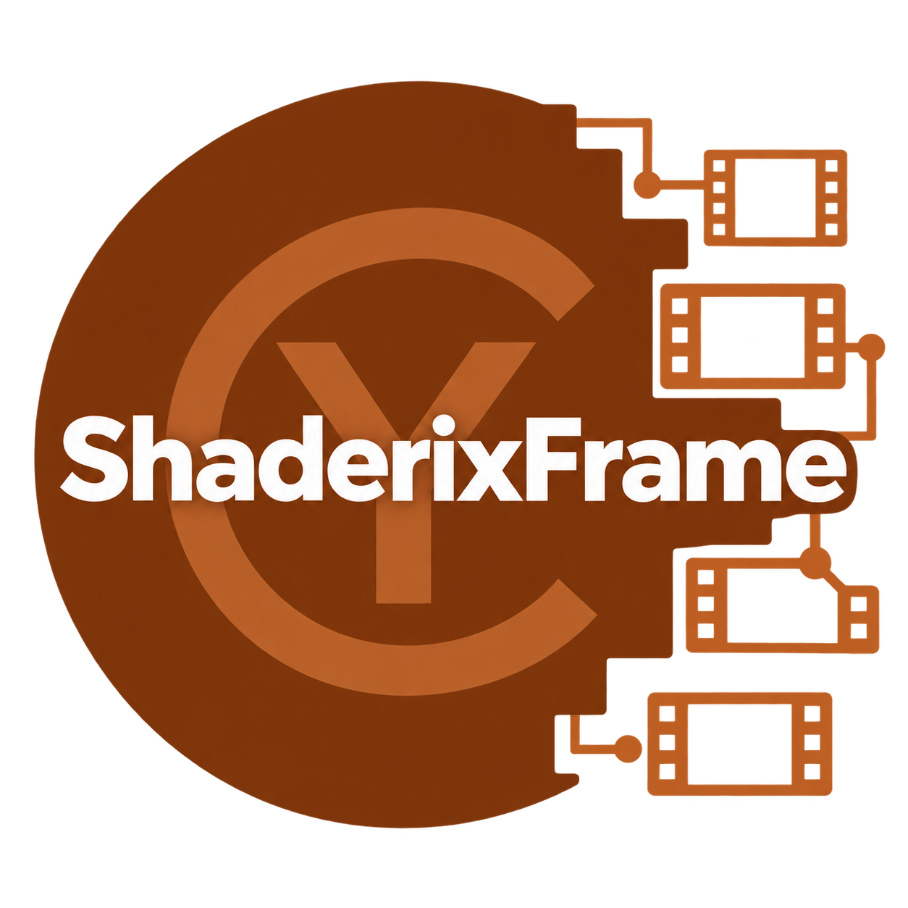
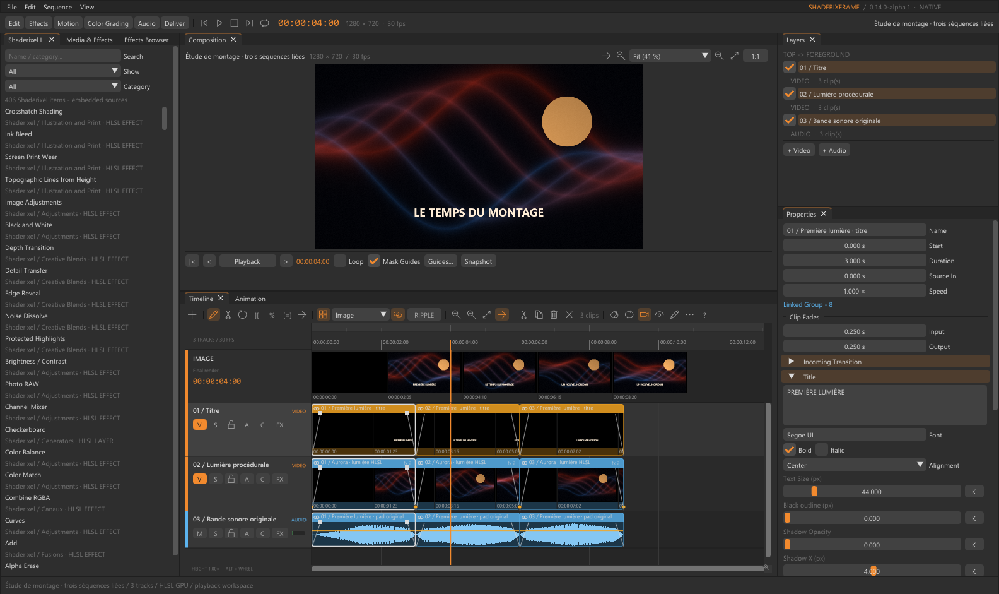
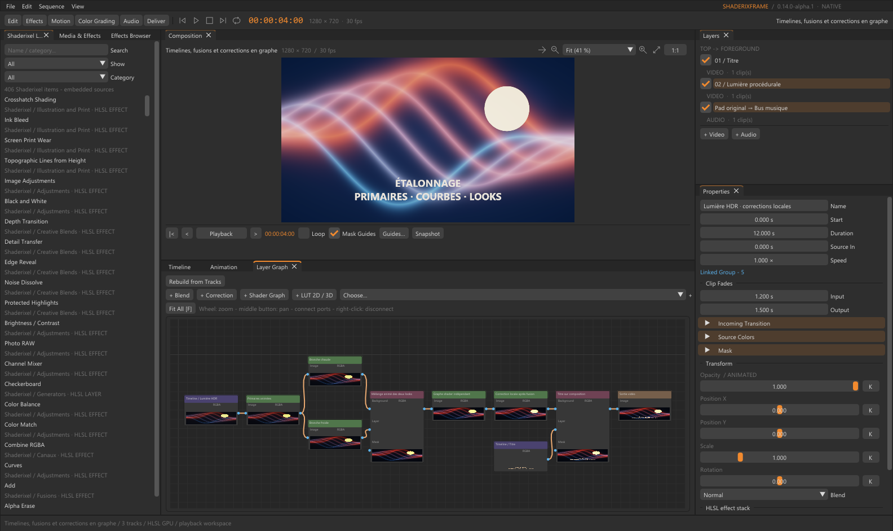
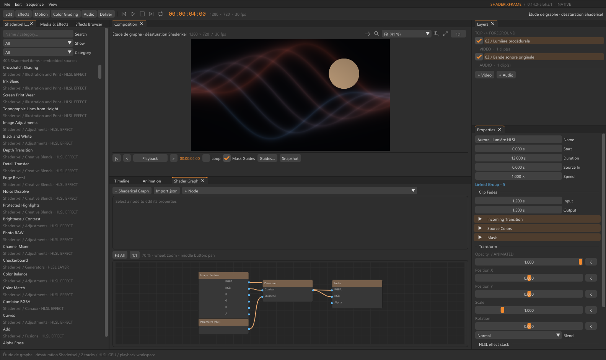
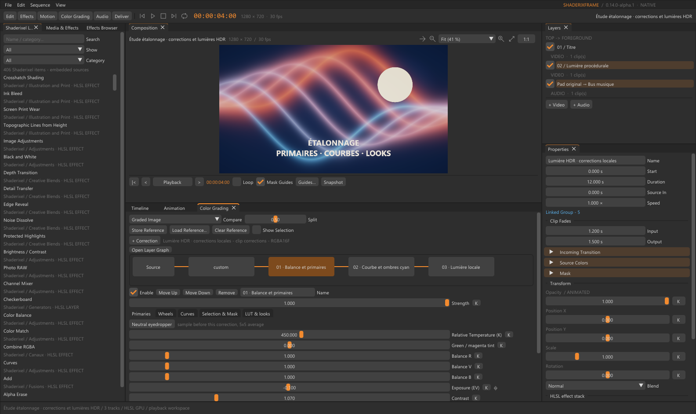
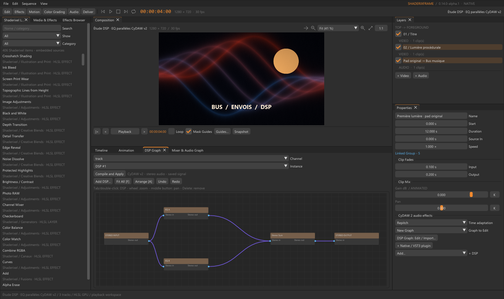
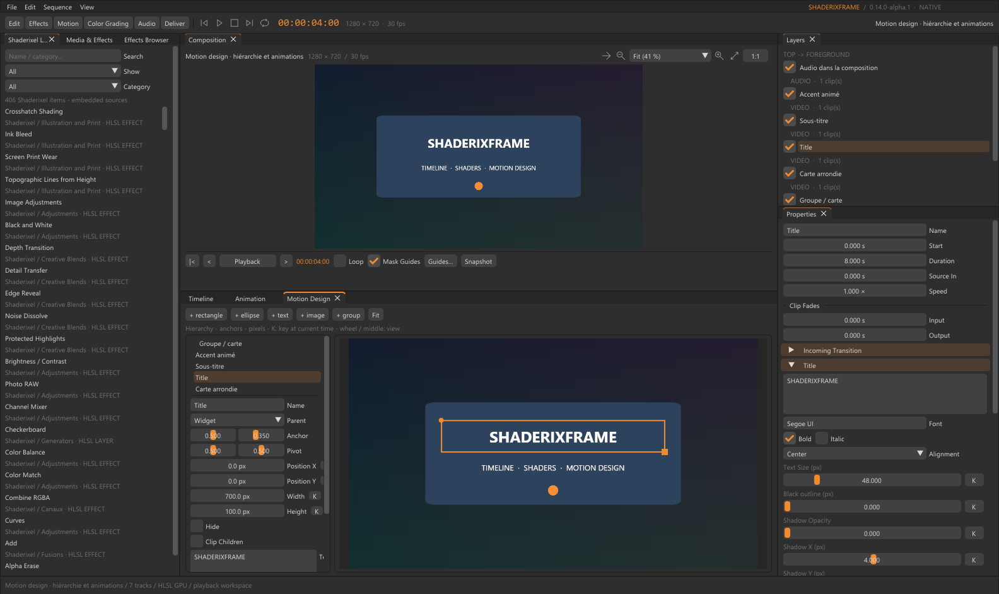
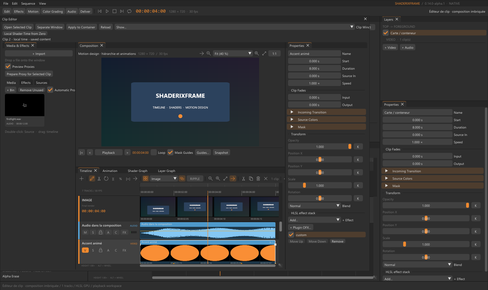

<table width="100%">
  <tr>
    <td width="300" align="left" valign="top">
      <a href="https://mrmybal.github.io/ShaderixFrame/Documentation.html#/en/welcome">Documentation</a><br>
      <a href="https://github.com/MrMybal/ShaderixFrame">Repository</a><br>
      <a href="https://github.com/MrMybal/ShaderixFrame/issues">Issue tracker</a><br><br>
      <sub>README</sub><br>
      <a href="README.md">English</a> · <a href="README.fr.md">Français</a>
    </td>
    <td width="400" align="center" valign="middle">
      
    </td>
    <td width="300" align="right" valign="top">
      <p><sub>Application license</sub><br><a href="LICENSE"><strong>GNU AGPL v3 only</strong></a></p>
      <p><sub>Version</sub><br><a href="docs/RELEASE_0.14-alpha.2.md"><strong>0.14.0-alpha.2</strong></a><br><strong>ALPHA</strong></p>
      <p><a href="https://github.com/MrMybal/ShaderixFrame/releases/tag/v0.14.0-alpha.2"><strong>Download</strong></a><br><sub>Windows x64 · installer / portable</sub></p>
    </td>
  </tr>
</table>

<h1 align="center">ShaderixFrame</h1>
<p align="center">By <a href="https://github.com/MrMybal">Cyberalien</a></p>

A native Windows video editor for video editing, HLSL-powered VFX, layered
compositing, motion design and audio processing. Assemble clips on a timeline,
build image and sound processing graphs, then animate and export the result.

> **ALPHA · 0.14.0-alpha.2**
>
> An experimental release for testing and feedback; features and compatibility
> remain subject to change. Alpha 2 adds the bilingual CyDoc manual, contextual
> help and public API reference. Read the [version notes and known limitations](docs/RELEASE_0.14-alpha.2.md).

[](docs/screenshots/editing.png)

Screenshots show **0.14.0-alpha.1** with bundled example projects. Click an image
to inspect it at full size; project names and titles may be in French.

## The application

Import video, images and sound, arrange linked clips, trim or retime them, and add
titles, masks and transitions. A clip can contain its own timeline, effects and
graphs. Six workspaces cover **Edit**, **Effects**, **Motion**, **Color Grading**,
**Audio** and **Deliver**. Panels can be closed, docked or detached onto another
screen. The interface starts in English; French is available in **View > Appearance**.

Shaderixel's shader compiler and composition algorithms provide the image graph
foundation. Track graphs process individual tracks, the layer graph blends their
surfaces, and shader graphs define HLSL effects. CyDAW v2 supplies the DSP engine,
audio graph validation and signal analysis; CyUI supplies common interface components.

| Layer compositing | HLSL shader graph |
| --- | --- |
| [](docs/screenshots/layer-graph.png) | [](docs/screenshots/shader-graph.png) |
| Blend tracks and branch corrections with live node previews. | Build effects by connecting shader nodes and parameters. |

| Color grading | Audio DSP graph |
| --- | --- |
| [](docs/screenshots/color-grading.png) | [](docs/screenshots/audio-dsp.png) |
| Stack corrections and adjust balance, exposure and contrast. | Route stereo audio through parallel processing branches. |

| Motion design | Nested clip editor |
| --- | --- |
| [](docs/screenshots/motion-design.png) | [](docs/screenshots/clip-editor.png) |
| Arrange text and shapes with a hierarchy and canvas. | Edit a container's local timeline, composition and effects. |

## Features

- **Editing:** linked video/audio clips, filmstrips, waveforms, trimming, retiming,
  nested timelines, markers, regions, subtitles and keyframe curves.
- **VFX and compositing:** separate layer and shader graphs, track effects,
  406 Shaderixel effects and generators, masks and transitions.
- **Color:** primaries, wheels, curves, qualifiers, local masks, scopes and
  1D/2D/3D LUTs. Internal compositing uses RGBA16F; PNG16 and EXR half export are
  available. Video decoding and encoding currently remain 8-bit.
- **Audio:** CyDAW v2 DSP graphs, 50 stereo insert effects, mixer, buses, sends,
  automation, loudness analysis and latency compensation. Native/VST3 audio plugins
  and the supported CPU RGBA OpenFX subset use isolated workers.
- **Delivery and recovery:** background MP4/WAV/AVI/PNG/EXR/GIF export, EDL/SRT
  interchange, undo history, project versions and session recovery.
- **Automation and help:** built-in MCP stdio server with 163 tools and an
  English/French CyDoc manual with guides and public MCP/C/C++ SDK references.

### Documentation

[Read the English manual](https://mrmybal.github.io/ShaderixFrame/Documentation.html#/en/welcome)
or [ouvrir le manuel français](https://mrmybal.github.io/ShaderixFrame/Documentation.html#/fr/welcome).
Both open the same visual reader as the application, with navigation, search,
screenshots, diagrams and a workspace gallery.

**Help > User Manual** opens the bundled `Documentation/Documentation.html` through
`file://`; **Ctrl+F1** chooses help for the active panel. Keep the entire
`Documentation/` directory, including `DocData/`, beside the executable. Reading
works offline without a server, CDN or Node runtime. Search with **Ctrl+K**;
images enlarge inside the window, and **Print guide** opens the complete guide.

---

## Installation

The published build targets **Windows 10/11 x64** and **Direct3D 11**.
The application and installer are unsigned. Third-party plugins are supplied by
their users; the compatible VST3 worker is included in the Windows packages.

1. [Download the 0.14.0-alpha.2 release](https://github.com/MrMybal/ShaderixFrame/releases/tag/v0.14.0-alpha.2).
   Choose the [per-user installer](https://github.com/MrMybal/ShaderixFrame/releases/download/v0.14.0-alpha.2/ShaderixFrame-0.14.0-alpha.2-Setup.exe)
   or the [portable ZIP](https://github.com/MrMybal/ShaderixFrame/releases/download/v0.14.0-alpha.2/ShaderixFrame-0.14.0-alpha.2-windows-x64.zip).
2. Run Setup, or extract the complete portable archive to a writable folder.
   Keep the workers, examples, licenses and documentation with the application.
3. Start `ShaderixFrame.exe`. Open **File > Open Project** and choose
   `examples/CutStudy.sframe`, or import your media with **Ctrl+I**.

The installer needs no administrator privileges. The distributed application
does not require the Shaderixel or CyDAW source projects. `--warp` selects software
D3D11 rendering. Release assets include [SHA-256 checksums](https://github.com/MrMybal/ShaderixFrame/releases/download/v0.14.0-alpha.2/SHA256SUMS.txt)
and [corresponding source with JUCE](https://github.com/MrMybal/ShaderixFrame/releases/download/v0.14.0-alpha.2/ShaderixFrame-0.14.0-alpha.2-source.zip).
See the [alpha limitations](docs/RELEASE_0.14-alpha.2.md#known-limitations) before evaluation.

## Source, build and required libraries

<details>
<summary>Build the Windows application from source</summary>

Use Windows x64, **Visual Studio 2022 with C++ x64 tools**, **CMake 3.24+**,
**Ninja**, **Python 3** and **Node.js 22+ / npm**. Node is used to generate help;
it is not needed by the installed application or reader.

```powershell
git clone https://github.com/MrMybal/ShaderixFrame.git
cd ShaderixFrame
npm ci --prefix .CyDocBuild --omit=peer --ignore-scripts
python tools/prepare_dependencies.py --audio-only
.\build.bat Release --safe-compile
```

This compiles Release without running test executables. The resulting application
is `build/Release/ShaderixFrame.exe`. CyUI, Shaderixel, CyDAW v2, Dear ImGui and
OpenFX sources are pinned under `vendor/`; CyDoc uses a local archive and npm lockfile
under `.CyDocBuild/`. Their licenses are indexed below.

The optional VST3 worker requires JUCE 8.0.15. Restore the matching worker from the
published portable ZIP, or rebuild it from the complete corresponding-source asset.
Follow [Building ShaderixFrame](docs/BUILDING.md) for those steps, tests and packaging.
Native audio/DSP and OFX hosting can build without that optional worker.

To regenerate and check both documentation languages:

```powershell
python tools/build_cydoc.py --check --test
```

The same export ships locally and is deployed by the documentation GitHub Actions
workflow. See [documentation tooling](.CyDocBuild/README.md) for authoring and
[the native SDK](sdk/README.md) for plugin contracts. Build products, generated media
and optional downloads stay outside Git; Git LFS is not required.

</details>

---

## License

**ShaderixFrame's original code and documentation use [GNU AGPL version 3 only](LICENSE)
(`AGPL-3.0-only`).** Copyright © 2026 Cyberalien. Third-party components retain their
own terms. See [licensing and corresponding source](docs/LICENSING.md).

### Application and native components

| Library · source | License · terms | Use / scope |
| --- | --- | --- |
| [Shaderixel snapshot](vendor/shaderixel) | [Owner-authorized copies and provenance](NOTICE.md) | Shader compiler, graph/composition code and effect library; bundled source. |
| [CyDAW v2 snapshot](vendor/cydaw2) | [GNU AGPL v3](vendor/cydaw2/LICENSE) | DSP engine, graph validation, analysis and VST3 worker source. |
| [CyUI 1.2.0](https://github.com/MrMybal/CyUI) | [MIT](vendor/cyui/LICENSE) | Native interface modules; pinned source is bundled. Upstream source access may require permission. |
| [Dear ImGui](https://github.com/ocornut/imgui) | [MIT](vendor/imgui/LICENSE.txt) | Docking and native UI; the application supplies one shared target. |
| [CyUI text/syntax components](vendor/cyui/THIRD_PARTY_NOTICES.md) | [MIT and HPND-style permissive notices](vendor/cyui/THIRD_PARTY_NOTICES.md) | TextEditor, Lexilla, Scintilla headers and SciTE data used by the code editor. |
| [JUCE 8.0.15](https://github.com/juce-framework/JUCE) | [AGPL v3 / commercial dual license](vendor/juce-license/LICENSE.md); AGPL option used here | VST3 worker only; exact source and dependency notices accompany the corresponding-source asset. |
| [OpenFX](https://github.com/AcademySoftwareFoundation/openfx) | [BSD-3-Clause](vendor/openfx/LICENSE.md) | Native OFX headers and host integration; selected examples also serve as development fixtures. |
| [CyDoc 0.1.0](https://github.com/MrMybal/CyDoc) | [MIT](.CyDocBuild/vendor/cydoc/LICENSE) | Bundled offline image/gallery reader and native route helper; generation tools remain separate. |

Windows APIs provide D3D11, Media Foundation, WIC and system fonts. System fonts and
third-party user plugins are not redistributed. CyUI's optional CEF/browser and
Unreal integrations are not used; the manual includes no Three.js runtime.

### Documentation generation and checks

| Library · source | License · terms | Use / scope |
| --- | --- | --- |
| [marked 17.0.6](https://github.com/markedjs/marked) | [MIT](https://github.com/markedjs/marked/blob/v17.0.6/LICENSE.md) | Build-time Markdown compilation through the locked CyDoc package. |
| [PrismJS 1.30.0](https://github.com/PrismJS/prism) | [MIT](https://github.com/PrismJS/prism/blob/v1.30.0/LICENSE) | Build-time syntax highlighting. |
| [esbuild 0.25.12](https://github.com/evanw/esbuild) | [MIT](https://github.com/evanw/esbuild/blob/v0.25.12/LICENSE.md) | Documentation bundling during generation. |
| [Happy DOM 21.0.4](https://github.com/capricorn86/happy-dom) | [MIT](https://github.com/capricorn86/happy-dom/blob/v21.0.4/LICENSE) | Development-only DOM checks; not an application or reader runtime. |

These tables index the main components, not every transitive dependency. Preserve
[NOTICE.md](NOTICE.md), [CyUI's component notices](vendor/cyui/THIRD_PARTY_NOTICES.md)
and all license files supplied with source and Windows packages.

## References and links

- [English documentation](https://mrmybal.github.io/ShaderixFrame/Documentation.html#/en/welcome)
  · [Documentation française](https://mrmybal.github.io/ShaderixFrame/Documentation.html#/fr/welcome).
- [Release notes and limitations](docs/RELEASE_0.14-alpha.2.md)
  · [Downloads](https://github.com/MrMybal/ShaderixFrame/releases/tag/v0.14.0-alpha.2).
- [MCP and SDK reference](https://mrmybal.github.io/ShaderixFrame/Documentation.html#/en/api-links)
  · [Build guide](docs/BUILDING.md).
- [Source repository](https://github.com/MrMybal/ShaderixFrame)
  · [Issue tracker](https://github.com/MrMybal/ShaderixFrame/issues).
